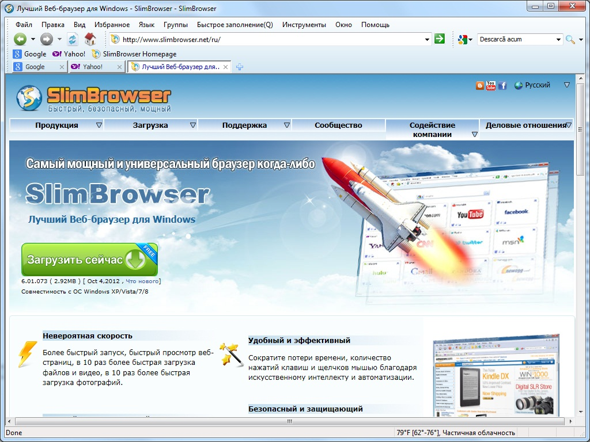
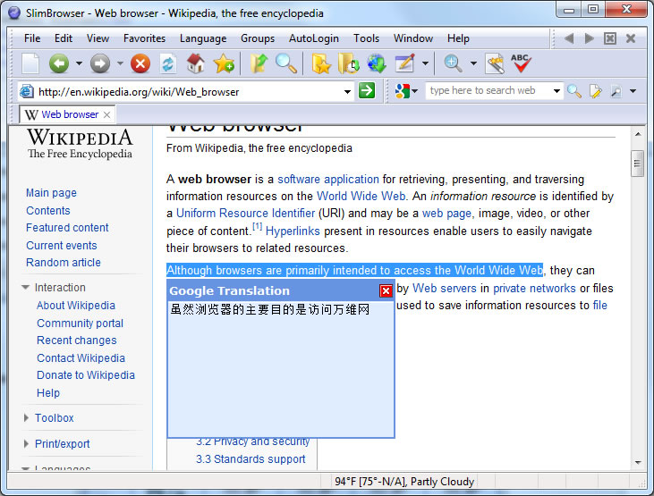

# SlimBrowser Lightweight Windows Web Browser

SlimBrowser is a lightweight tabbed web browser for Windows developed by FlashPeak.

It combines a familiar browser interface with built-in tools for downloading, popup control, URL filtering, form filling, translation, screenshots, and everyday web navigation.

## Project Snapshot

| Property | Value |
| --- | --- |
| Product | SlimBrowser |
| Developer | FlashPeak, Inc. |
| Product type | Lightweight Windows web browser |
| Primary platform | Microsoft Windows |
| Browser model | Tabbed desktop browser |
| Main focus | Speed, convenience, browsing utilities, and customization |
| Distribution | Installer and portable-style Windows packages |
| Public source repository | Not confirmed |

## Browser Experience

SlimBrowser is designed for users who want a compact Windows browser with common browsing tools available from the main interface.

The browser experience includes:

- Tabbed browsing
- Customizable toolbars
- Multiple open pages
- Fast page navigation
- Session-oriented workflows
- Popup control
- URL filtering
- Download management
- Form completion
- Page translation
- Screenshot capture
- Weather information
- Browser utility panels

## Windows Focus

SlimBrowser is intended primarily for Windows desktop systems.

Its Windows-oriented design emphasizes:

- Traditional desktop controls
- Familiar menus and toolbars
- Windows download workflows
- Portable usage scenarios
- Lightweight installation
- Compatibility with common Windows setups
- Support for older Windows environments in historical releases

Compatibility can vary by version, operating-system build, processor architecture, and the web rendering engine included with the release.

## Tabbed Browsing

Tabs allow users to keep multiple web pages inside one browser window.

Typical tab workflows include:

- Opening links in new tabs
- Switching between active pages
- Closing individual tabs
- Reopening recently closed pages
- Arranging browsing sessions
- Keeping research pages together
- Separating work and personal browsing
- Using several pages without opening many windows

## Download Manager

SlimBrowser includes a multithreaded download manager intended to improve download handling.

Download workflows may include:

- Starting multiple downloads
- Resuming interrupted transfers
- Monitoring download progress
- Organizing downloaded files
- Handling broken connections
- Accessing downloads from the browser interface
- Reducing the need for a separate download utility

Actual performance depends on the server, network, file source, and browser version.

## Popup Control

The browser includes a popup killer for reducing unwanted browser windows.

Popup controls can help users:

- Block unsolicited windows
- Reduce disruptive advertising
- Keep browsing inside the active tab
- Improve page readability
- Limit unexpected navigation
- Configure exceptions for trusted websites

Popup blocking does not guarantee that every advertising script, overlay, or redirect will be removed.

## URL Filtering

SlimBrowser provides customizable URL filtering.

Filtering can be used to:

- Block selected addresses
- Reduce unwanted content
- Limit known advertising URLs
- Restrict distracting resources
- Create personal browsing rules
- Adjust behavior for specific websites

Users should review filter rules regularly because web pages and resource addresses change over time.

## QuickFill Form Filler

QuickFill is intended to simplify repeated form entry.

It can assist with:

- Login forms
- Contact details
- Registration fields
- Repeated address information
- Frequently used form values
- Browser profile data

Saved form and login information should be protected with the same care as passwords and other personal data.

## Translation Tools

SlimBrowser includes built-in translation features for web pages and selected text.

Translation workflows can help users:

- Read foreign-language pages
- Translate selected passages
- Compare wording
- Understand navigation elements
- Support multilingual research
- Switch between source and translated content

Machine translation may contain errors and should not be treated as authoritative for legal, medical, or contractual content.

## Screenshot Utility

The browser includes a screenshot utility for capturing visible page content.

Screenshot workflows can be useful for:

- Saving visual references
- Recording page states
- Capturing tutorials
- Sharing browser problems
- Documenting web interfaces
- Creating notes from online research

Screenshots may contain personal information, account details, or copyrighted material. Review captured images before sharing them.

## Weather and Utility Panels

SlimBrowser includes additional utility features such as weather information.

These tools can provide:

- Local weather summaries
- Quick access to browser utilities
- Convenience information beside browsing tasks
- Optional page-side tools
- A more integrated desktop workflow

Availability may depend on the installed release and external service availability.

## Privacy and Security

SlimBrowser includes popup and URL filtering features, but these should not be interpreted as a complete privacy or security system.

Users should also consider:

- Browser update availability
- Operating-system support
- Certificate validation
- Password storage
- Extension permissions
- Downloaded file safety
- Website security
- Tracking scripts
- Account protection
- Antivirus and endpoint policies

The product is proprietary, so its internal implementation and current security maintenance should be verified through official FlashPeak information.

## Browser Engine

The supplied product brief identifies SlimBrowser as using the Gecko rendering engine.

The rendering engine affects:

- Web compatibility
- JavaScript behavior
- CSS support
- Media playback
- Extension compatibility
- Certificate handling
- Page performance
- Support for modern web standards

Older engine versions may fail on websites that require current browser APIs or security features.

## Architecture Reference

The provided local reference files belong to qutebrowser, a different open-source browser project. They are included as structural references for browser packaging, testing, metadata, and desktop integration.

They are not SlimBrowser source files.

The reference Python entry point is [qutebrowser.py](./qutebrowser.py).

Project packaging metadata is available in [pyproject.toml](./pyproject.toml), [setup.py](./setup.py), and [MANIFEST.in](./MANIFEST.in).

Runtime dependencies are described by [requirements.txt](./requirements.txt).

Static analysis and test configuration are represented by [pyrightconfig.json](./pyrightconfig.json), [pytest.ini](./pytest.ini), and [tox.ini](./tox.ini).

## Desktop Integration Reference

The supplied reference set contains desktop integration files for a Linux desktop browser.

These include:

- [misc/org.qutebrowser.qutebrowser.desktop](./misc/org.qutebrowser.qutebrowser.desktop)
- [misc/org.qutebrowser.qutebrowser.appdata.xml](./misc/org.qutebrowser.qutebrowser.appdata.xml)
- [misc/qutebrowser.spec](./misc/qutebrowser.spec)
- [misc/apparmor/usr.bin.qutebrowser](./misc/apparmor/usr.bin.qutebrowser)
- [misc/Makefile](./misc/Makefile)

These files document packaging patterns and are not claims about SlimBrowser's internal packaging.

## Browser Utility Scripts

The local reference files include scripts for browser testing, configuration, import, and diagnostics.

Examples include:

- [scripts/mkvenv.py](./scripts/mkvenv.py)
- [scripts/importer.py](./scripts/importer.py)
- [scripts/hist_importer.py](./scripts/hist_importer.py)
- [scripts/opengl_info.py](./scripts/opengl_info.py)
- [scripts/keytester.py](./scripts/keytester.py)
- [scripts/open_url_in_instance.sh](./scripts/open_url_in_instance.sh)
- [scripts/setupcommon.py](./scripts/setupcommon.py)
- [scripts/utils.py](./scripts/utils.py)

The reference test browser implementations include [scripts/testbrowser/testbrowser_webengine.py](./scripts/testbrowser/testbrowser_webengine.py) and [scripts/testbrowser/testbrowser_webkit.py](./scripts/testbrowser/testbrowser_webkit.py).

## Browser Compatibility Notes

SlimBrowser users should verify compatibility before relying on it for daily work.

Potential compatibility concerns include:

- Newer JavaScript APIs
- Modern CSS features
- WebAssembly applications
- Streaming media
- Web authentication
- Web push notifications
- Hardware-backed security
- Banking websites
- Government portals
- Modern extension APIs
- Single-page applications

A browser can remain useful for lightweight browsing while still being unsuitable for websites that require newer standards.

## Portable Usage

Historical SlimBrowser searches commonly reference portable use.

Portable browser usage can be useful when:

- Installing software is restricted
- A user works from removable storage
- Several browser profiles are needed
- A temporary environment is required
- A browser should be kept separate from the system profile
- A user wants to carry settings between compatible Windows systems

Portable use can expose credentials and browsing history if the storage device is lost or shared.

## Form and Password Data

QuickFill and saved browser credentials can contain sensitive information.

Recommended precautions include:

- Use a protected Windows account
- Avoid storing credentials on shared computers
- Review saved data periodically
- Remove old accounts
- Protect portable storage
- Keep backups encrypted
- Do not reuse passwords
- Use multi-factor authentication when available

## Product Positioning

SlimBrowser is positioned as a practical Windows browser with integrated utilities rather than a large ecosystem platform.

Its main appeal is the combination of:

- Lightweight desktop browsing
- Built-in download handling
- Popup blocking
- URL filtering
- Form filling
- Translation
- Screenshots
- Convenience panels
- Traditional Windows workflows

## Current Availability

SlimBrowser release availability, supported Windows versions, processor architectures, and package types should be checked through the official FlashPeak distribution channels.

No public official source repository or current release number was confirmed during this research stage.

## Support and Maintenance

Users should verify:

- Whether a release is still maintained
- Which Windows versions are supported
- Whether security updates are published
- Whether the rendering engine remains current
- Whether download links are official
- Whether third-party mirrors are trustworthy
- Whether old versions should be avoided

Archived installers should be scanned and tested before use.

## License and Ownership

SlimBrowser is associated with FlashPeak, Inc.

The exact license terms, redistribution permissions, and proprietary component notices should be reviewed in the official product documentation and installer terms.

## Related Search Terms

FlashPeak SlimBrowser, SlimBrowser portable, SlimBrowser for PC, SlimBrowser official website, SlimBrowser 64 bit, windows-browser, lightweight-browser, gecko-browser, popup-blocker, download-manager, form-filler, web-browser, privacy-browser, browser-tools
